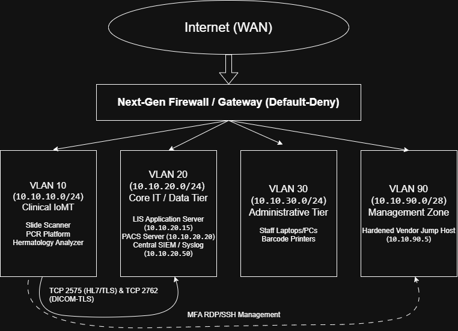

# Clinical IoMT Security Architecture & HIPAA Compliance Assessment

An audit-ready defensive engineering and governance model designed to isolate networked clinical diagnostic instruments, mitigate vulnerabilities in legacy operational technology (OT), and fulfill the technical safeguards of the HIPAA Security Rule (45 CFR Part 164 Subpart C).

---

## Executive Summary
Clinical testing laboratories rely on connected diagnostic devices—such as automated hematology analyzers, real-time PCR platforms, and digital slide scanners—that directly process electronic Protected Health Information (ePHI). 

Because these instruments run embedded, vendor-locked operating systems that cannot be patched without regulatory re-certification, they represent high-risk attack surfaces. This project demonstrates how to defend these devices using strict network containment, zero-trust routing, and regulatory control mapping:

1. **STRIDE Threat Modeling:** Identifies threat vectors specific to lab instrument firmware, cleartext protocols, and shared operator terminals.
2. **Layer 3/4 Network Segmentation:** Implements a default-deny VLAN architecture that eliminates lateral movement from corporate endpoints and prevents direct outbound internet egress.
3. **HIPAA Safeguards Matrix:** Translates federal compliance mandates into concrete technical implementations with verifiable audit evidence.

---

## Architectural Topology

---

## Repository Contents

| Document | Focus Area | Description |
| :--- | :--- | :--- |
| [`docs/threat-model.md`](docs/threat-model.md) | **Threat Modeling** | STRIDE vulnerability analysis for diagnostic hardware, cleartext HL7/DICOM streams, and mitigating technical controls. |
| [`docs/network-architecture.md`](docs/network-architecture.md) | **Network Engineering** | Subnet zoning (VLANs 10, 20, 30, 90), traffic profiles, and an explicit default-deny firewall Access Control List (ACL). |
| [`docs/hipaa-safeguards-matrix.md`](docs/hipaa-safeguards-matrix.md) | **Governance & Compliance** | Detailed crosswalk mapping technical architecture decisions to 45 CFR § 164.312 requirements and audit artifacts. |

---

## Core Defensive Principles
* **Default-Deny Inter-VLAN Routing:** Medical instruments cannot establish connections to administrative user subnets.
* **Zero Direct Egress:** The clinical IoMT subnet (`10.10.10.0/24`) is strictly blocked from the public WAN to prevent command-and-control (C2) callbacks and telemetry leaks.
* **Encrypted In-Transit Transactions:** Cleartext HL7 v2 and DICOM payloads are encapsulated via TLS 1.3 tunnels before crossing VLAN boundaries.
* **Compensating Controls for Legacy OS:** Switch-port isolation and strict ingress filtering protect older embedded operating systems that cannot receive security patches.

---
*Disclaimer: Reference architecture and compliance framework developed for healthcare information security analysis and portfolio demonstration.*
